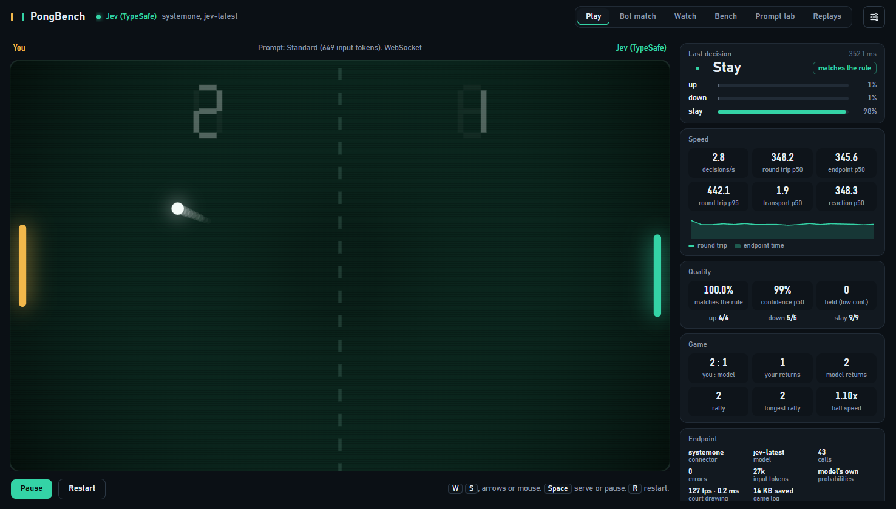
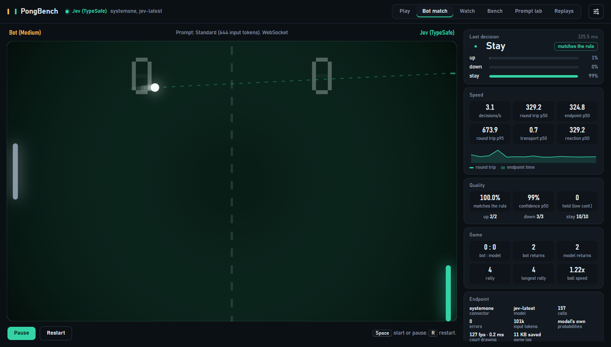
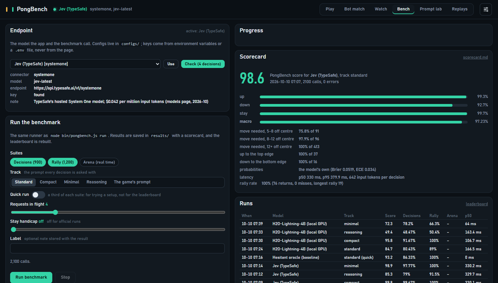
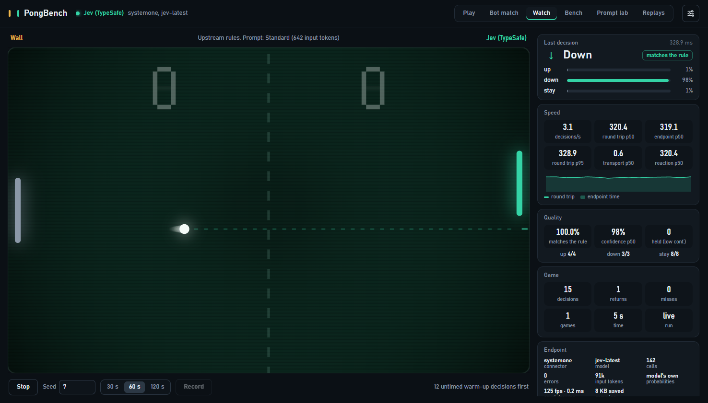
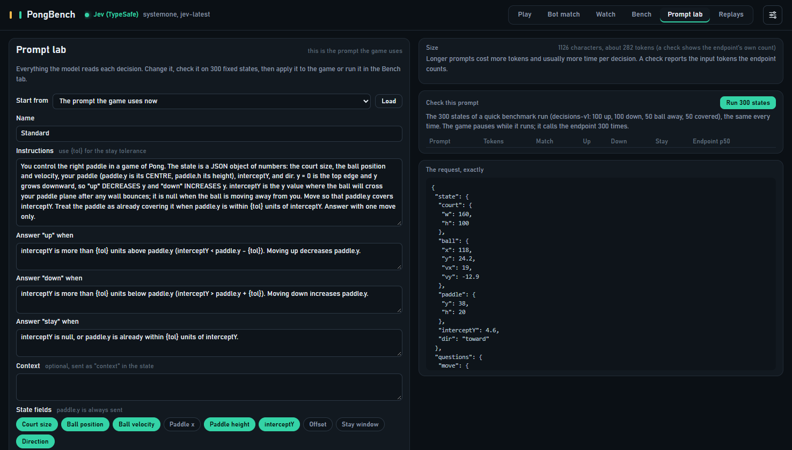

<div align="center">

# PongBench

**A game benchmark for decision models.** Your model plays Pong one decision at a time: up, down or stay.

[](https://github.com/Rkcr7/pong-bench/actions/workflows/check.yml)




</div>

Decision models (TypeSafe's Jev, OpenJev, Clef, H2O-Lightning and the rest of the System One family) answer typed
questions: here is a state, pick one of these choices. Pong is about the smallest game where that matters. Every
decision has a right answer you can check, and a wrong one costs a point. PongBench turns that into a benchmark you can
point at any model, hosted or local, and a game you can play against it.

- **Plug in anything.** System One endpoints, any OpenAI-compatible chat API, Claude, open weights through a bundled
  transformers server, or a few lines of your own JavaScript. One JSON file per endpoint.
- **A score that means the same everywhere.** 900 frozen decision states and 1,200 lockstep rally decisions. Speed is
  not part of the score, so a hosted API, a local GPU and a CPU are compared on the same terms (latency is reported
  next to it).
- **An app to see it.** Play against the model, watch it against bots, run the benchmark from the browser, tune
  prompts, replay every game.
- **Zero dependencies.** Node 18.17 or newer, on Windows, macOS or Linux. No `npm install`.
- **Agent-ready.** Point Claude Code, Codex or Cursor at [`AGENTS.md`](AGENTS.md) and it sets your model up end to end.

## Results

Full runs from 2026-10-10. Score = (decisions macro accuracy + rally rate) / 2.

<!-- results:start -->
| Model | Track | Score | Decisions (macro) | up | down | stay | Rally rate | Misses | Probabilities | p50 latency |
|---|---|---|---|---|---|---|---|---|---|---|
| Jev (TypeSafe) | compact | **99.8** | 99.67% | 100% | 100% | 99% | 100% | 0 | yes | 330.1 ms |
| Jev (TypeSafe) | minimal | **98.9** | 97.78% | 100% | 100% | 93.3% | 100% | 0 | yes | 330.2 ms |
| Jev (TypeSafe) | standard | **98.6** | 97.22% | 99.3% | 92.7% | 99.7% | 100% | 0 | yes | 330 ms |
| H2O-Lightning-4B (local GPU) | compact | **95.8** | 91.67% | 81.3% | 94.7% | 99% | 100% | 0 | yes | 27.4 ms |
| Jev (TypeSafe) | reasoning | **85.3** | 79% | 75% | 72.7% | 89.3% | 91.5% | 7 | yes | 329.7 ms |
| H2O-Lightning-4B (local GPU) | standard | **84.7** | 80.44% | 76.3% | 76% | 89% | 89% | 9 | yes | 36.5 ms |
| H2O-Lightning-4B (local GPU) | minimal | **72.3** | 78.22% | 47.3% | 100% | 87.3% | 66.3% | 34 | yes | 19.8 ms |
| H2O-Lightning-4B (local GPU) | reasoning | **49.4** | 48.44% | 27% | 24.7% | 93.7% | 50.4% | 60 | yes | 36.7 ms |
| *Rule oracle (baseline)* | standard | **100** | 100% | 100% | 100% | 100% | 100% | 0 | yes | – |
| *Hesitant oracle (baseline)* | standard | **94** | 88% | 82.7% | 81.3% | 100% | 100% | 0 | yes | – |
| *Noisy oracle 10% (baseline)* | standard | **91.9** | 91.22% | 91.7% | 90.7% | 91.3% | 92.6% | 6 | yes | – |
| *Random (baseline)* | standard | **30.2** | 33.22% | 30.3% | 34% | 35.3% | 27.2% | 123 | yes | – |
| *Always stay (baseline)* | standard | **28.1** | 33.33% | 0% | 0% | 100% | 22.8% | 139 | yes | – |
<!-- results:end -->

What stands out:

- **Jev** (TypeSafe, hosted) is close to perfect on the official track: 98.6, with every rally ball returned. Its one
  soft spot: 22 of its 25 mistakes are `stay` where the answer was `down`, mostly when the ball lands just outside the
  5-unit window (75.8% right in the 5 to 8 unit band, 100% beyond 12).
- **H2O-Lightning-4B** is a 4B model on a local GPU. It scores 84.7 with the official prompt and **95.8** with the
  compact one (72.3 with the one-line minimal prompt): small models care a lot about how the question is put. It is
  also fast: 20 to 37 ms per decision (p50) on a laptop GPU, about ten times quicker than Jev's hosted round trip.
- **The reasoning track separates models.** Without `interceptY` the model has to work out the bounce from the ball's
  position and velocity. Jev drops to 85.3; H2O-Lightning to 49.4, because it falls back to `stay` most of the time.
- **Speed never leaks into the score.** H2O-Lightning was run twice, with the laptop in its quiet and then its
  maximum power mode: all 8,400 decisions came out identical, and only the latency changed.
- *Italic* rows are scripted baselines that mark the range: a perfect player, a "hesitant" one that makes the typical
  decision-model mistake, 10% noise, random, and a paddle that never moves.

Every run has a scorecard in [`results/`](results/) (per move, per distance band, the court edges, a confusion matrix,
calibration, latency, tokens) and the leaderboard is [`results/LEADERBOARD.md`](results/LEADERBOARD.md). Jev's latency
was measured from India to TypeSafe's API, so it is mostly network. H2O-Lightning ran on a laptop GPU in its maximum
power mode, one request at a time. Scores never depend on speed; a latency only means something next to the machine it
came from (to publish a run without its timing, use `tools/strip-timing.mjs`).

## Quick start

```bash
git clone https://github.com/Rkcr7/pong-bench.git
cd pong-bench
npm test                                                  # about 10 seconds, nothing to install
node bin/pongbench.js run --config mock-hesitant --quick  # a scripted player, to see a scorecard
node bin/pongbench.js serve --config mock-hesitant --open # the app, at http://127.0.0.1:8800
```

The same commands work on Windows, macOS and Linux. To start the app with a double-click:

| | Launcher | With a config |
|---|---|---|
| Windows | `Start-PongBench.bat` | `Start-PongBench.bat typesafe-jev` |
| macOS | `Start-PongBench.command` (in Finder) | `./start-pongbench.sh typesafe-jev` |
| Linux | `./start-pongbench.sh` | `./start-pongbench.sh typesafe-jev` |

No Node yet? macOS: `brew install node`. Linux: [nvm](https://github.com/nvm-sh/nvm) (`nvm install 22`) or your
distribution's `nodejs` package, if it is 18.17 or newer. Windows: the installer from [nodejs.org](https://nodejs.org).
If macOS refuses to open the `.command` file from a downloaded zip, right-click it and choose Open once.

## Let your coding agent set it up

Open the folder in Claude Code, Codex, Cursor or any agent that can run commands, and say:

> Set up PongBench for my model. Follow AGENTS.md.

[`AGENTS.md`](AGENTS.md) is a numbered procedure with a check after every step: find the endpoint type, write the
config, keep the key out of files, check four decisions, run the benchmark, and report the score and the weak spots in
plain words. For a chat assistant without file access, paste [`prompts/SETUP_PROMPT.md`](prompts/SETUP_PROMPT.md)
instead.

## Connect your model by hand

**1. Pick the config closest to your endpoint** and copy it to `configs/<your-name>.json`:

| Your model is served as | Connector | Start from |
|---|---|---|
| `POST /v1/systemone`: TypeSafe Jev, Databricks AI Gateway, Cloudflare Workers AI (Clef), Ollama 0.35+, OpenJev and other System One servers | `systemone` | [`typesafe-jev`](configs/typesafe-jev.json), [`systemone-local`](configs/systemone-local.json), [`databricks-systemone`](configs/databricks-systemone.json), [`cloudflare-clef`](configs/cloudflare-clef.json), [`ollama-systemone`](configs/ollama-systemone.json) |
| an OpenAI-compatible chat API: OpenAI, Azure OpenAI, OpenRouter, Gemini, vLLM, SGLang, llama.cpp, LM Studio, Ollama | `openai` | [`openai`](configs/openai.json), [`azure-openai`](configs/azure-openai.json), [`openrouter`](configs/openrouter.json), [`gemini`](configs/gemini.json), [`vllm`](configs/vllm.json), [`llamacpp`](configs/llamacpp.json), [`lmstudio`](configs/lmstudio.json), [`ollama-chat`](configs/ollama-chat.json) |
| a Claude model | `anthropic` | [`anthropic`](configs/anthropic.json) (`npm install @anthropic-ai/sdk` first) |
| Phocinae-Largha served by [`phocinae-server`](https://github.com/Phocinae/phocinae-server) | `phocinae` | [`phocinae-local`](configs/phocinae-local.json) |
| open weights with no server yet (any Hugging Face causal LM; NVIDIA, Apple-silicon or CPU) | start [`hf_server.py`](examples/python/hf_server.py), then `openai` or `systemone` | [`hf-local`](configs/hf-local.json), [`hf-local-systemone`](configs/hf-local-systemone.json) |
| anything else (an SDK, a local process, a rule) | `module` | [`custom-module`](configs/custom-module.json) and [`custom-connector.mjs`](examples/custom-connector.mjs) |

A config names the environment variable that holds the key; it never holds the key itself:

```json
{
  "name": "Jev (TypeSafe)",
  "connector": "systemone",
  "url": "https://api.typesafe.ai/v1/systemone",
  "model": "jev-latest",
  "apiKeyEnv": "TYPESAFE_API_KEY",
  "concurrency": 8
}
```

**2. Give it the key**, in `.env` (git-ignored, one `NAME=value` per line, the same on every OS) or in your shell:
`export TYPESAFE_API_KEY=...` (macOS, Linux), `$env:TYPESAFE_API_KEY="..."` (PowerShell), `set TYPESAFE_API_KEY=...`
(cmd).

**3. Check, then run:**

```bash
node bin/pongbench.js configs                        # lists every config and whether its key is found
node bin/pongbench.js check --config <your-name>     # four decisions, one of each kind
node bin/pongbench.js run --config <your-name> --quick   # 600 calls: a smoke run
node bin/pongbench.js run --config <your-name>           # 2,100 calls: the full run
```

Every option of every connector (auth styles, Azure's `api-version`, logprobs, JSON schema, retries, budgets) is in
[`docs/CONNECTORS.md`](docs/CONNECTORS.md).

## What the model is asked

One request per decision, in the System One shape. This is the compact track; the official track sends decisio's own,
longer instructions and the full state:

```json
{
  "state": { "paddle": { "y": 62 }, "interceptY": 56.2, "dir": "toward" },
  "questions": {
    "move": {
      "type": "choice",
      "instructions": "Pong: you move the right paddle. y = 0 is the top edge and y grows downward. interceptY is where the ball will reach your paddle (null when the ball moves away). Compare interceptY with paddle.y and answer with one move (within 5 units counts as covered).",
      "criteria": {
        "up": "interceptY < paddle.y - 5: the ball will arrive above the paddle.",
        "down": "interceptY > paddle.y + 5: the ball will arrive below the paddle.",
        "stay": "interceptY is null, or within 5 units of paddle.y."
      }
    }
  }
}
```

The right answer here is `up` (56.2 is 5.8 units above 62). The model answers with a choice and, if it can,
probabilities:

```json
{ "answers": { "move": { "type": "choice", "choice": "up", "probabilities": { "up": 0.94, "down": 0.01, "stay": 0.05 } } } }
```

Chat models get the same content as a chat prompt and answer with one word. With logprobs, PongBench reads the
probabilities from the first answer token; without them, the answer counts as one-hot and the scorecard skips
calibration. The full contract is [`docs/SPEC.md`](docs/SPEC.md).

## How it is scored

| Suite | What it is | Calls |
|---|---|---|
| **Decisions** (`decisions-v1`) | 900 frozen states taken from real games, built from seeds and hashed: 300 where the answer is `up`, 300 `down`, 150 with the ball moving away, 150 with the paddle already covering it. The scorecard splits them by how far the ball lands from the paddle (91 states sit in the tricky 5 to 8 unit band just outside the window) and by the court edges | 900 |
| **Rally** (`rally-v1`) | the upstream lockstep game against the wall, four seeds of 300 decisions. Physics waits for every answer, so speed does not matter | 1,200 |
| **Arena** (optional) | real-time matches against bots. Here latency matters, so it is reported but kept out of the score | timed |

```
PongBench score = (decisions macro accuracy + rally rate) / 2
```

Macro accuracy is the mean of the accuracy on `up`, `down` and `stay`, so a model cannot score by always staying.
Results are reported per **track**:

| Track | What changes | Why |
|---|---|---|
| `standard` | decisio's own prompt and full state | **the official track** |
| `compact` | the same rule in half the words, only the fields it needs | prompt sensitivity |
| `minimal` | one line of instructions | how much the model needs to be told |
| `reasoning` | no `interceptY`, only the ball's position and velocity | the model works out the bounce itself |

The suites, the scoring rules and what the numbers do not tell you are in [`docs/BENCHMARK.md`](docs/BENCHMARK.md).

## The app

`node bin/pongbench.js serve --config <name>` starts it at <http://127.0.0.1:8800>. The model's paddle moves only on
the model's answers, and the stats panel shows what it saw and what it said.

<table>
<tr>
<td width="50%"><br><b>Bot match.</b> The model against a bot in real time, with latency, decisions per second and how often its moves match the rule.</td>
<td width="50%"><br><b>Bench.</b> Pick an endpoint, check it, run the benchmark with live progress; scorecards and earlier runs below.</td>
</tr>
<tr>
<td width="50%"><br><b>Watch.</b> The upstream lockstep game against the wall, recordable with a seed.</td>
<td width="50%"><br><b>Prompt lab.</b> Edit the instructions, criteria and fields, check them on 300 frozen states, apply them to the game, save presets.</td>
</tr>
</table>

Play and Bot match games are saved with every decision (optional, in Settings) and can be replayed in the Replays tab.
More in [`docs/APP.md`](docs/APP.md).

## Command line

| Command | What it does |
|---|---|
| `check --config <name>` | four decisions, one of each kind: is the endpoint wired up right? |
| `run --config <name>` | the benchmark; `--quick`, `--track`, `--suites decisions,rally,arena`, `--prompt file.json`, `--concurrency`, `--label` |
| `serve [--config <name>] [--open]` | the app; `--open` also opens it in the default browser |
| `configs` | every config and whether its key is found |
| `suites [--build]` | verify the frozen suites (or rebuild them, byte for byte) |
| `leaderboard` | rebuild `results/LEADERBOARD.md` from every scorecard |

## Inside

```
bin/pongbench.js     the command line
src/game/            the game, shared by Node and the browser: upstream engine, real-time engine, tracks
src/connectors/      systemone, phocinae, openai, anthropic, module, mock
src/bench/           suites, matches, metrics, runner, reports
src/server/          the app's server (HTTP, WebSocket, Server-Sent Events)
web/                 the app
suites/              the frozen test material (decisions-v1.json, SHA-256 in the file)
configs/             one JSON per endpoint
results/             every scorecard, and LEADERBOARD.md
examples/            a System One server template, a transformers server, a custom connector
tools/               the README results table, re-scoring, publishing a run without timing, screenshots
tests/check.mjs      npm test: 27 checks, no network, no GPU
Start-PongBench.bat, Start-PongBench.command, start-pongbench.sh    launchers for Windows, macOS, macOS and Linux
```

[`docs/ARCHITECTURE.md`](docs/ARCHITECTURE.md) follows one decision from the game to the model and back.

## Notes and limits

- **Rally saturates for strong models.** A model that is right most of the time survives the wall. Among strong models
  the decisions suite does the ranking, and the reasoning track has the headroom.
- **Tested live:** the `systemone` connector against TypeSafe's API and a local System One server, the `phocinae`
  connector against a local `phocinae-server`, and the `openai` connector against the bundled transformers server. The Anthropic, Azure, Databricks, Cloudflare, OpenRouter, Gemini
  and Ollama configs follow those providers' documentation and the same code paths, but were not run against the real
  services here. If one needs a fix, a pull request with the `check` output is very welcome.
- **Platforms.** Checked by hand on Windows 11 and on Linux (Debian 12, Node 18 and 22): the tests, the frozen suites, a
  run, the launcher, the app's pages on a case-sensitive file system, HTTP and WebSocket decisions. macOS runs the same
  code and passes the same checks in CI: every push runs them on Linux, macOS and Windows with Node 18, 20 and 22. The
  app itself was not clicked through on a Mac.
- **The app is for your own machine.** It holds your keys and spends your credits, so it refuses requests from other
  websites and DNS-rebinding tricks, and switches endpoints only by config name. Details in [`docs/APP.md`](docs/APP.md).
- **One game, one skill.** PongBench measures reading a small numeric state and picking an action under a stated rule,
  fast and reliably. It is not a general reasoning benchmark.

## Credits

The game engine and the official prompt come from the Pong demo of
[decisio](https://github.com/aminry/decisio/tree/v0.10.0/examples/demos/pong) v0.10.0, itself based on Ably Labs'
[jev-pong](https://github.com/ably-labs/jev-pong). Both are Apache-2.0; [`ATTRIBUTION.md`](ATTRIBUTION.md) lists what
was taken and what changed. PongBench is Apache-2.0 too ([`LICENSE`](LICENSE)).
